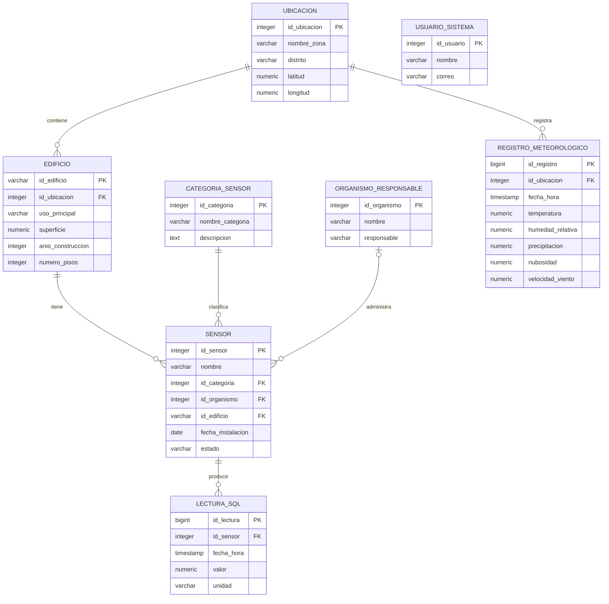

# Arquitectura y decisiones de diseño PostgreSQL — SmartCityCE

## 1. Objetivo

Este documento describe la arquitectura, el modelo relacional y las principales decisiones de diseño adoptadas para la implementación de PostgreSQL en SmartCityCE.

La documentación se basa en el esquema implementado en `SQL/01_schema.sql` y complementa los documentos desarrollados durante las etapas de diseño y normalización del modelo.

Se incluyen los siguientes aspectos:

- Modelo entidad-relación implementado.
- Descripción de las entidades principales.
- Relaciones, claves primarias y claves foráneas.
- Normalización hasta tercera forma normal (3FN).
- Restricciones utilizadas para garantizar la integridad de los datos.
- Índices y su justificación.
- Vistas y funciones implementadas.
- Consultas SQL relevantes.
- Principales decisiones de diseño.
- Justificación del uso de PostgreSQL dentro de la arquitectura del proyecto.

El objetivo es proporcionar una visión consolidada del componente relacional del sistema y de las decisiones tomadas durante su diseño e implementación.


## 2. Rol de PostgreSQL en la arquitectura

SmartCityCE utiliza PostgreSQL como sistema de gestión de bases de datos relacional para almacenar la información estructurada y las relaciones principales del sistema.

PostgreSQL contiene entidades como ubicaciones, edificios, sensores, categorías de sensores, organismos responsables y usuarios del sistema. También permite almacenar una selección de lecturas eléctricas y registros meteorológicos que pueden utilizarse en consultas relacionales y análisis SQL.

El uso de PostgreSQL resulta apropiado para este componente debido a que permite:

- Definir relaciones mediante claves primarias y foráneas.
- Aplicar restricciones de integridad como `NOT NULL`, `UNIQUE` y `CHECK`.
- Organizar la información mediante un esquema normalizado.
- Ejecutar consultas que combinan información de diferentes entidades mediante `JOIN`.
- Realizar agregaciones y consultas analíticas.
- Crear índices para optimizar operaciones frecuentes.
- Definir vistas y funciones reutilizables.

Dentro de la arquitectura general de SmartCityCE, PostgreSQL se utiliza principalmente para los datos estructurados y las relaciones entre entidades. Las series temporales de mayor volumen pueden almacenarse en componentes orientados al manejo documental o al procesamiento de grandes volúmenes de datos.

Esta separación evita utilizar una única tecnología para todos los tipos de información y permite aprovechar las características de cada sistema de almacenamiento según la naturaleza de los datos.

## 3. Modelo entidad-relación implementado

El modelo relacional implementado está compuesto por ocho entidades principales. El siguiente diagrama representa el esquema definido actualmente en `SQL/01_schema.sql`.



### 3.1 Relaciones principales

Las relaciones implementadas en el esquema son las siguientes:

- Una `ubicacion` puede contener múltiples `edificio`.
- Cada `edificio` pertenece a una única `ubicacion`.
- Un `edificio` puede tener múltiples `sensor`.
- Cada `sensor` pertenece a una `categoria_sensor`.
- Un `organismo_responsable` puede estar asociado con múltiples sensores. La asociación es opcional para el sensor.
- Un `sensor` puede producir múltiples registros en `lectura_sql`.
- Una `ubicacion` puede tener múltiples registros en `registro_meteorologico`.

La entidad `usuario_sistema` se mantiene independiente dentro del esquema actual, debido a que no se ha definido una relación directa con las demás entidades.

La ubicación de los sensores asociados a edificios se obtiene mediante la relación:

`SENSOR → EDIFICIO → UBICACION`

Por esta razón, el esquema implementado no almacena directamente `id_ubicacion` dentro de `sensor`, evitando duplicar la ubicación que ya puede determinarse a partir del edificio.


## 4. Descripción de entidades

El esquema PostgreSQL de SmartCityCE está compuesto por ocho entidades que separan los datos maestros, la información de los sensores y los registros de medición.

### 4.1 `ubicacion`

Representa las zonas geográficas utilizadas por el sistema. Almacena el nombre de la zona, distrito y coordenadas geográficas mediante latitud y longitud.

Esta entidad permite agrupar edificios y asociar registros meteorológicos con una ubicación determinada.

### 4.2 `edificio`

Representa los edificios incluidos en el conjunto de datos. Cada edificio pertenece a una ubicación mediante `id_ubicacion`.

Además de su identificador, almacena información descriptiva como el uso principal, superficie, año de construcción y número de pisos.

El campo `id_edificio` utiliza el identificador proveniente del conjunto de datos como clave primaria, lo que permite conservar la trazabilidad con la fuente original.

### 4.3 `categoria_sensor`

Funciona como catálogo para clasificar los sensores. Cada categoría posee un identificador, un nombre único y una descripción opcional.

Separar las categorías en una entidad independiente evita repetir la información de clasificación en cada sensor y facilita agregar o modificar categorías.

### 4.4 `organismo_responsable`

Representa las organizaciones responsables de administrar o supervisar sensores.

La relación con `sensor` es opcional, por lo que pueden existir sensores para los cuales todavía no se haya registrado un organismo responsable.

### 4.5 `sensor`

Representa los sensores o medidores utilizados por el sistema.

Cada sensor pertenece obligatoriamente a una categoría y puede estar asociado con un organismo responsable y un edificio. También almacena su fecha de instalación y estado.

El estado se limita a los valores `activo`, `inactivo`, `mantenimiento` y `desconocido`, lo que permite mantener valores consistentes dentro de la base de datos.

### 4.6 `usuario_sistema`

Representa los usuarios registrados en el sistema. Almacena un nombre y un correo electrónico único.

Actualmente esta entidad no posee relaciones directas con otras tablas del modelo. Se mantiene como parte independiente del esquema para representar los usuarios del sistema y permitir futuras funcionalidades relacionadas con acceso o gestión.

### 4.7 `lectura_sql`

Almacena las lecturas asociadas con los sensores.

Cada registro contiene el sensor que produjo la lectura, la fecha y hora de la medición, su valor y la unidad correspondiente. La combinación de sensor y fecha-hora debe ser única, evitando registrar dos lecturas del mismo sensor para el mismo instante.

Esta tabla permite realizar consultas temporales, agregaciones y análisis relacionales sobre una selección de las mediciones disponibles.

### 4.8 `registro_meteorologico`

Almacena las observaciones meteorológicas asociadas con una ubicación.

Incluye fecha y hora, temperatura, humedad relativa, precipitación, nubosidad y velocidad del viento. La combinación de ubicación y fecha-hora es única.

Esta entidad permite relacionar las condiciones meteorológicas con las zonas monitoreadas y utilizarlas como contexto para el análisis de los datos energéticos.

## 5. Relaciones, claves primarias y claves foráneas

El modelo utiliza claves primarias para identificar de forma única cada registro y claves foráneas para mantener la integridad referencial entre las entidades.

### 5.1 Claves primarias

| Entidad | Clave primaria | Tipo |
|---|---|---|
| `ubicacion` | `id_ubicacion` | `INTEGER` generado automáticamente |
| `edificio` | `id_edificio` | `VARCHAR(100)` |
| `categoria_sensor` | `id_categoria` | `INTEGER` generado automáticamente |
| `organismo_responsable` | `id_organismo` | `INTEGER` generado automáticamente |
| `sensor` | `id_sensor` | `INTEGER` generado automáticamente |
| `usuario_sistema` | `id_usuario` | `INTEGER` generado automáticamente |
| `lectura_sql` | `id_lectura` | `BIGINT` generado automáticamente |
| `registro_meteorologico` | `id_registro` | `BIGINT` generado automáticamente |

La mayoría de las entidades utilizan identificadores generados mediante `GENERATED ALWAYS AS IDENTITY`. En el caso de `edificio`, se conserva `id_edificio` como identificador proveniente del conjunto de datos original.

Para las tablas de mediciones (`lectura_sql` y `registro_meteorologico`) se utiliza `BIGINT` como clave primaria debido a que estas tablas pueden almacenar una cantidad considerablemente mayor de registros que las entidades maestras.

### 5.2 Claves foráneas

| Tabla | Clave foránea | Referencia | Propósito |
|---|---|---|---|
| `edificio` | `id_ubicacion` | `ubicacion(id_ubicacion)` | Determina la ubicación a la que pertenece el edificio. |
| `sensor` | `id_categoria` | `categoria_sensor(id_categoria)` | Clasifica cada sensor dentro de una categoría. |
| `sensor` | `id_organismo` | `organismo_responsable(id_organismo)` | Asocia opcionalmente el sensor con su organismo responsable. |
| `sensor` | `id_edificio` | `edificio(id_edificio)` | Asocia opcionalmente el sensor con un edificio. |
| `lectura_sql` | `id_sensor` | `sensor(id_sensor)` | Identifica el sensor que produjo una lectura. |
| `registro_meteorologico` | `id_ubicacion` | `ubicacion(id_ubicacion)` | Asocia cada observación meteorológica con una ubicación. |

### 5.3 Integridad referencial

Las claves foráneas impiden registrar referencias hacia entidades inexistentes. Por ejemplo, una lectura no puede asociarse con un `id_sensor` que no exista en la tabla `sensor`.

No todas las relaciones tienen la misma obligatoriedad. Algunas claves foráneas, como `edificio.id_ubicacion`, `sensor.id_categoria`, `lectura_sql.id_sensor` y `registro_meteorologico.id_ubicacion`, utilizan `NOT NULL` y por lo tanto requieren una entidad relacionada.

En cambio, `sensor.id_organismo` y `sensor.id_edificio` admiten valores `NULL`. Esto permite representar sensores para los cuales no se haya definido un organismo responsable o un edificio asociado.

## 6. Normalización hasta tercera forma normal

El modelo relacional fue analizado y normalizado hasta tercera forma normal (3FN). El análisis detallado se encuentra en [`normalizacion.md`](./normalizacion.md).

### 6.1 Primera forma normal (1FN)

Las tablas utilizan atributos atómicos y no almacenan listas o grupos repetitivos dentro de una misma columna.

Un caso importante corresponde a las mediciones eléctricas del dataset original, que se encuentran en formato ancho, con una columna para cada serie de medición. Para almacenarlas en PostgreSQL, las mediciones se transforman a registros individuales en `lectura_sql`, utilizando una estructura basada en:

`(id_sensor, fecha_hora, valor, unidad)`

Esto permite representar cada medición como una fila independiente y evita crear columnas adicionales para cada sensor.

### 6.2 Segunda forma normal (2FN)

Las entidades utilizan claves primarias de un solo atributo, por lo que los atributos no clave dependen completamente de su respectiva clave primaria y no existen dependencias parciales respecto a las claves primarias implementadas.

Las combinaciones utilizadas como restricciones `UNIQUE`, como `(id_sensor, fecha_hora)` en `lectura_sql`, representan reglas adicionales de unicidad y no sustituyen las claves primarias de las tablas.

### 6.3 Tercera forma normal (3FN)

El diseño separa información que pertenece a entidades diferentes para evitar dependencias transitivas y redundancia.

Por ejemplo:

- La información de una categoría se almacena únicamente en `categoria_sensor` y los sensores mantienen solamente `id_categoria` como referencia.
- Los datos del organismo responsable se almacenan en `organismo_responsable` y no se repiten dentro de cada sensor.
- La ubicación de un sensor asociado a un edificio se obtiene mediante `sensor → edificio → ubicacion`, evitando almacenar nuevamente `id_ubicacion` en `sensor`.
- Las lecturas eléctricas se almacenan independientemente de los datos descriptivos del sensor.
- Los registros meteorológicos se relacionan con `ubicacion` mediante su clave foránea, evitando repetir la información geográfica en cada observación.

Como resultado, el esquema implementado mantiene separadas las entidades maestras y las mediciones, reduce la redundancia y permite conservar la consistencia de las relaciones mediante claves foráneas.

## 7. Restricciones de integridad

Además de las claves primarias y foráneas, el esquema utiliza restricciones para evitar datos duplicados, valores inválidos y registros incompletos.

### 7.1 Restricciones `NOT NULL`

Los atributos esenciales utilizan `NOT NULL` cuando su valor es necesario para que el registro tenga sentido dentro del modelo.

Algunos ejemplos son:

- `ubicacion.nombre_zona`.
- `edificio.id_ubicacion`.
- `categoria_sensor.nombre_categoria`.
- `organismo_responsable.nombre` y `responsable`.
- `sensor.nombre`, `id_categoria` y `estado`.
- `usuario_sistema.nombre` y `correo`.
- `lectura_sql.id_sensor`, `fecha_hora`, `valor` y `unidad`.
- `registro_meteorologico.id_ubicacion` y `fecha_hora`.

Otros atributos admiten `NULL` cuando la información puede no estar disponible, como la fecha de instalación de un sensor o algunos datos descriptivos de los edificios.

### 7.2 Restricciones `UNIQUE`

Se utilizan restricciones de unicidad para evitar registros duplicados en atributos o combinaciones que deben ser únicas.

Las principales son:

- `categoria_sensor.nombre_categoria`.
- `sensor.nombre`.
- `usuario_sistema.correo`.
- `(id_sensor, fecha_hora)` en `lectura_sql`.
- `(id_ubicacion, fecha_hora)` en `registro_meteorologico`.

Las dos últimas restricciones evitan almacenar más de una medición para el mismo sensor o ubicación en un mismo instante.

### 7.3 Restricciones `CHECK`

El esquema utiliza restricciones `CHECK` para validar diferentes dominios de datos:

- La latitud debe encontrarse entre `-90` y `90`.
- La longitud debe encontrarse entre `-180` y `180`.
- La superficie de un edificio debe ser mayor que cero.
- El año de construcción debe ser posterior a `1800`.
- El número de pisos debe ser mayor que cero.
- El estado de un sensor debe pertenecer a `activo`, `inactivo`, `mantenimiento` o `desconocido`.
- El correo de un usuario debe contener el carácter `@` en una posición válida.
- La unidad de una lectura no puede ser una cadena vacía.
- La humedad relativa debe encontrarse entre `0` y `100`.
- La precipitación no puede ser negativa.
- La nubosidad debe encontrarse entre `0` y `100`.
- La velocidad del viento no puede ser negativa.

Estas validaciones permiten rechazar parte de los datos inconsistentes directamente desde PostgreSQL, independientemente de las validaciones realizadas por los scripts de carga.

### 7.4 Valores predeterminados

El campo `sensor.estado` utiliza el valor predeterminado:

`desconocido`

De esta forma, cuando no se dispone de información suficiente para determinar el estado de un sensor, se registra explícitamente como desconocido en lugar de asumir que se encuentra activo o inactivo.

## 8. Índices y justificación

Además de los índices asociados automáticamente con claves primarias y restricciones `UNIQUE`, se definieron índices adicionales para optimizar operaciones frecuentes sobre las tablas con mayor relevancia en las consultas.

Los índices se encuentran implementados en `SQL/03_indexes.sql`.

### 8.1 Índice sobre la fecha de las lecturas

```sql
CREATE INDEX IF NOT EXISTS idx_lectura_fecha_hora
    ON lectura_sql (fecha_hora);
```

El índice `idx_lectura_fecha_hora` optimiza las consultas que filtran las lecturas eléctricas por fecha o por intervalos de tiempo.

Este índice resulta especialmente importante debido al volumen de registros que puede alcanzar `lectura_sql` y a que gran parte de los análisis de las mediciones utilizan rangos temporales.

### 8.2 Índice sobre el edificio de un sensor

```sql
CREATE INDEX IF NOT EXISTS idx_sensor_id_edificio
    ON sensor (id_edificio);
```

El índice `idx_sensor_id_edificio` facilita las consultas que buscan sensores pertenecientes a un edificio y las operaciones `JOIN` entre `sensor` y `edificio`.

Esta relación también se utiliza indirectamente para determinar la ubicación de un sensor mediante:

`sensor → edificio → ubicacion`

### 8.3 Índice sobre la ubicación de un edificio

```sql
CREATE INDEX IF NOT EXISTS idx_edificio_id_ubicacion
    ON edificio (id_ubicacion);
```

El índice `idx_edificio_id_ubicacion` facilita las operaciones que relacionan edificios con ubicaciones y las consultas que buscan los edificios o sensores asociados con una zona determinada.

### 8.4 Criterio de selección

No se crearon índices adicionales sobre las claves primarias ni sobre columnas que ya poseen restricciones `UNIQUE`, debido a que PostgreSQL genera los índices necesarios para soportar dichas restricciones.

También se evitó crear índices indiscriminadamente, ya que cada índice requiere espacio adicional y puede aumentar el costo de las operaciones de inserción y actualización.

Después de crear los índices se ejecuta `ANALYZE` sobre `lectura_sql`, `sensor` y `edificio` para actualizar las estadísticas utilizadas por el planificador de consultas de PostgreSQL.

El archivo `SQL/queries/03_advanced_queries.sql` incluye además una consulta con `EXPLAIN ANALYZE` que permite comprobar el plan de ejecución y evaluar el uso de índices.

## 9. Vistas y funciones

Para facilitar la reutilización de consultas y simplificar el acceso a información relacionada, se implementaron una vista y una función en PostgreSQL.

Estos objetos se encuentran definidos en `SQL/05_views.sql` y `SQL/06_functions.sql`.

### 9.1 Vista `vw_sensor_resumen`

La vista `vw_sensor_resumen` proporciona una representación consolidada de la información de los sensores.

Combina datos provenientes de:

- `sensor`
- `categoria_sensor`
- `organismo_responsable`
- `edificio`
- `ubicacion`
- `lectura_sql`

Para cada sensor, la vista permite consultar información como su categoría, organismo responsable, edificio, ubicación, fecha de instalación y estado.

Además, calcula:

- `cantidad_lecturas`: número de lecturas registradas para el sensor.
- `ultima_actividad`: fecha y hora de la lectura más reciente.

La vista utiliza `LEFT JOIN` para conservar sensores aunque no tengan organismo, edificio, ubicación o lecturas asociadas.

Su principal ventaja es evitar repetir los mismos `JOIN` y agregaciones en las consultas que necesitan un resumen general de los sensores.

Un ejemplo de uso es:

```sql
SELECT *
FROM public.vw_sensor_resumen;
```

### 9.2 Función `fn_sensores_por_ubicacion`

La función:

```sql
fn_sensores_por_ubicacion(p_id_ubicacion INTEGER)
```

recibe el identificador de una ubicación y devuelve los sensores asociados con los edificios pertenecientes a esa zona.

El resultado incluye:

- Identificador y nombre del sensor.
- Categoría del sensor.
- Organismo responsable.
- Edificio asociado.
- Nombre de la zona.
- Estado.
- Fecha de instalación.

Por ejemplo:

```sql
SELECT *
FROM public.fn_sensores_por_ubicacion(1);
```

La función fue definida como `STABLE`, ya que realiza una consulta sobre los datos existentes sin modificarlos.

Debido al modelo relacional implementado, la función determina la ubicación mediante la relación:

`sensor → edificio → ubicacion`

Por lo tanto, un sensor que no tenga un edificio asociado no puede ser localizado mediante esta función.

### 9.3 Propósito dentro del proyecto

La vista y la función permiten encapsular consultas utilizadas con frecuencia y proporcionan una interfaz SQL más sencilla para acceder a información relacionada.

Además, estos objetos permiten cubrir las consultas obligatorias del proyecto que requieren utilizar una vista y una función o procedimiento almacenado.

## 10. Consultas implementadas

Las consultas PostgreSQL del proyecto se encuentran organizadas dentro del directorio `SQL/queries/`. Se separaron según su nivel y propósito para facilitar su mantenimiento y ejecución.

### 10.1 Consultas básicas y relaciones

El archivo `SQL/queries/01_basic_joins.sql` contiene consultas orientadas a las operaciones fundamentales de SQL y a la relación entre las entidades del modelo.

Incluye ejemplos de:

- `SELECT`
- `WHERE`
- `ORDER BY`
- `DISTINCT`
- `JOIN`
- `INNER JOIN`
- `LEFT JOIN`

También contiene una consulta de integración que relaciona datos eléctricos de BDG2 con registros meteorológicos mediante ubicación y fecha-hora.

### 10.2 Agregaciones y consultas analíticas

El archivo `SQL/queries/02_aggregations.sql` contiene consultas de agregación sobre las mediciones almacenadas.

Se utilizan operaciones como:

- `GROUP BY`
- `HAVING`
- `COUNT`
- `SUM`
- `AVG`
- `MIN`
- `MAX`

Entre los análisis implementados se encuentran estadísticas por sensor y unidad, así como resúmenes diarios de las mediciones.

### 10.3 Consultas avanzadas

El archivo `SQL/queries/03_advanced_queries.sql` contiene consultas que utilizan características más avanzadas de PostgreSQL.

Se implementan:

- Subconsultas.
- Expresiones comunes de tabla (`CTE`).
- Agregaciones temporales.
- Funciones de ventana mediante `ROW_NUMBER()`.
- Consultas y filtros por fecha.
- Comprobación de índices mediante `EXPLAIN ANALYZE`.

Estas consultas permiten realizar análisis sobre períodos de tiempo y estudiar el comportamiento del planificador de consultas de PostgreSQL.

### 10.4 Consultas obligatorias del proyecto

El archivo `SQL/queries/04_queries.sql` contiene las diez consultas PostgreSQL requeridas para el proyecto.

| N.º | Consulta | Propósito |
|---:|---|---|
| 1 | Sensores por tipo | Cuenta los sensores existentes según su categoría. |
| 2 | Sensores por ubicación | Relaciona los sensores con la ubicación de sus edificios. |
| 3 | Sensores activos e inactivos | Cuenta sensores según su estado, incluyendo mantenimiento y desconocido. |
| 4 | Sensores por organismo responsable | Relaciona los sensores con el organismo encargado de ellos. |
| 5 | Ubicaciones con mayor cantidad de sensores | Agrupa y ordena las ubicaciones según el número de sensores asociados. |
| 6 | Sensores instalados por año | Agrupa los sensores según su fecha de instalación. |
| 7 | Sensores sin actividad | Identifica sensores que no poseen lecturas registradas. |
| 8 | Ranking de zonas monitoreadas | Ordena las zonas según la cantidad de registros eléctricos y meteorológicos asociados. |
| 9 | Consulta utilizando una vista | Utiliza `vw_sensor_resumen` para consultar los sensores con mayor cantidad de lecturas. |
| 10 | Consulta utilizando una función | Utiliza `fn_sensores_por_ubicacion` para obtener los sensores correspondientes a una ubicación. |

### 10.5 Consideraciones sobre los datos disponibles

Algunas consultas dependen de la disponibilidad de información en las fuentes de datos.

En particular, la consulta de sensores instalados por año contempla que actualmente pueden existir sensores sin `fecha_instalacion`. Estos registros se mantienen identificados como información no disponible en lugar de asignar fechas artificiales.

De manera similar, las consultas fueron diseñadas para considerar relaciones opcionales, como sensores sin organismo responsable o sin edificio asociado, cuando corresponde.

Esta estrategia permite que las consultas representen el estado real de los datos almacenados sin asumir información que no se encuentra disponible en las fuentes originales.

## 11. Decisiones de diseño

Durante el diseño e implementación de PostgreSQL se tomaron diferentes decisiones con el objetivo de mantener la integridad, reducir la redundancia y conservar la trazabilidad con las fuentes de datos utilizadas por SmartCityCE.

### 11.1 Separación entre datos maestros y mediciones

La información descriptiva se mantiene separada de las mediciones.

Entidades como `ubicacion`, `edificio`, `categoria_sensor`, `organismo_responsable` y `sensor` almacenan información relativamente estable, mientras que `lectura_sql` y `registro_meteorologico` representan observaciones que pueden crecer continuamente.

Esta separación facilita las consultas, evita repetir información descriptiva en cada medición y mantiene el modelo normalizado.

### 11.2 Conservación del identificador original de los edificios

La tabla `edificio` utiliza `id_edificio` como clave primaria de tipo `VARCHAR` en lugar de generar un identificador numérico nuevo.

Esto permite conservar el identificador proveniente de BDG2 y facilita relacionar los metadatos de los edificios con las series de medición correspondientes.

### 11.3 Ubicación de los sensores mediante edificios

El esquema implementado no almacena directamente `id_ubicacion` dentro de `sensor`.

Cuando un sensor está asociado con un edificio, su ubicación puede obtenerse mediante:

`sensor → edificio → ubicacion`

Esta decisión evita almacenar dos veces la misma relación geográfica y reduce el riesgo de inconsistencias entre la ubicación registrada para un sensor y la ubicación de su edificio.

### 11.4 Catálogo independiente de categorías

Las categorías de sensores se almacenan en `categoria_sensor` y los sensores mantienen únicamente la referencia mediante `id_categoria`.

Esto evita repetir el nombre y la descripción de una categoría para cada sensor y permite modificar la información de una categoría desde un único registro.

### 11.5 Relaciones opcionales

Los campos `sensor.id_organismo` y `sensor.id_edificio` permiten valores `NULL`.

Esta decisión permite representar información incompleta sin crear datos artificiales cuando no se dispone de un organismo responsable o de un edificio asociado.

### 11.6 Tratamiento de información desconocida

No se asignan valores que aparenten provenir de las fuentes cuando la información no está disponible.

Por ejemplo, `fecha_instalacion` puede permanecer en `NULL` y el estado del sensor utiliza `desconocido` como valor predeterminado.

Esto permite diferenciar entre información realmente disponible y datos que todavía no han sido determinados.

### 11.7 Separación de tecnologías de almacenamiento

PostgreSQL se utiliza para representar el componente estructurado y relacional de SmartCityCE. Las relaciones entre sensores, edificios, ubicaciones, categorías y organismos se benefician de las restricciones de integridad y de las operaciones relacionales disponibles en PostgreSQL.

Las mediciones de mayor volumen pueden ser manejadas por otros componentes de la arquitectura destinados a datos documentales o procesamiento masivo.

Esta separación permite utilizar cada tecnología según las características de los datos y evita concentrar todas las responsabilidades de almacenamiento y procesamiento en una única base de datos.

### 11.8 Optimización selectiva

Los índices fueron definidos sobre columnas utilizadas en filtros temporales y relaciones frecuentes, en lugar de crear índices sobre todos los atributos.

De esta manera se busca mejorar el rendimiento de las consultas relevantes sin introducir innecesariamente el costo de almacenamiento y mantenimiento asociado con un número excesivo de índices.

## 12. Archivos relacionados

La implementación y documentación del componente PostgreSQL se encuentra distribuida en los siguientes archivos:

| Archivo | Propósito |
|---|---|
| `SQL/01_schema.sql` | Define las tablas, claves, relaciones y restricciones del esquema PostgreSQL. |
| `SQL/03_indexes.sql` | Define los índices adicionales y actualiza las estadísticas mediante `ANALYZE`. |
| `SQL/05_views.sql` | Implementa la vista `vw_sensor_resumen`. |
| `SQL/06_functions.sql` | Implementa la función `fn_sensores_por_ubicacion`. |
| `SQL/queries/01_basic_joins.sql` | Contiene consultas básicas y operaciones `JOIN`. |
| `SQL/queries/02_aggregations.sql` | Contiene agregaciones y consultas analíticas. |
| `SQL/queries/03_advanced_queries.sql` | Contiene subconsultas, CTE, funciones de ventana, consultas temporales y comprobación de índices. |
| `SQL/queries/04_queries.sql` | Contiene las diez consultas PostgreSQL obligatorias del proyecto. |
| `docs/SQL/modelo_entidad_relacion.md` | Documenta el diseño conceptual inicial del modelo entidad-relación. |
| `docs/SQL/normalizacion.md` | Documenta el proceso de normalización hasta tercera forma normal. |
| `docs/SQL/justificacion_indices.md` | Contiene la justificación detallada de los índices implementados. |
| `docs/SQL/views_functions.md` | Documenta el propósito de la vista y la función implementadas. |
| `docs/SQL/carga_datos.md` | Documenta el proceso de carga de datos en PostgreSQL. |

Los documentos de diseño representan las etapas previas de desarrollo del modelo. Para consultar la estructura finalmente implementada, `SQL/01_schema.sql` se considera la referencia principal del esquema actual.


## 13. Conclusión

La arquitectura PostgreSQL de SmartCityCE proporciona un modelo relacional para almacenar y consultar la información estructurada del sistema.

El esquema implementado utiliza ocho entidades y establece relaciones mediante claves primarias y foráneas. La normalización hasta tercera forma normal reduce la redundancia entre las entidades, mientras que las restricciones `NOT NULL`, `UNIQUE` y `CHECK` contribuyen a mantener la integridad de los datos.

Los índices adicionales optimizan filtros temporales y relaciones utilizadas frecuentemente. Por otra parte, la vista `vw_sensor_resumen` y la función `fn_sensores_por_ubicacion` permiten reutilizar operaciones que combinan información de diferentes tablas.

Las consultas implementadas cubren operaciones básicas, relaciones, agregaciones y características avanzadas de PostgreSQL, además de las diez consultas requeridas para el proyecto.

De esta manera, PostgreSQL funciona como el componente relacional de SmartCityCE, proporcionando una estructura consistente para las entidades principales y complementándose con las demás tecnologías utilizadas para el almacenamiento y procesamiento de otros tipos y volúmenes de datos.
