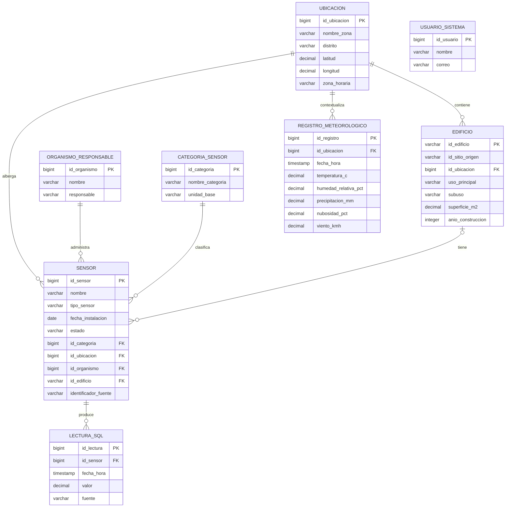

# SmartCityCE — Modelo entidad-relación de PostgreSQL

**Issue:** #2 — Diseñar modelo entidad-relación PostgreSQL  
**Dominio:** Energía urbana  
**Estado:** Diseño conceptual propuesto; todavía no corresponde al DDL ni demuestra la normalización 3FN (Issues #3 y #4).

## 1. Objetivo

Definir en `/SQL` el modelo entidad-relación del componente relacional de SmartCityCE, identificando entidades, atributos, llaves primarias y foráneas, cardinalidades y decisiones de diseño. La propuesta parte de las columnas verificadas de `metadata.csv`, una muestra de `electricity_cleaned.csv` y el CSV de Open-Meteo, y distingue la información real de los atributos añadidos para cumplir el enunciado.

## 2. Alcance y fuentes examinadas

- **BDG2 / `metadata.csv`:** 1.636 registros de edificios, de los cuales 136 tienen `site_id = Panther`. Campos relevantes: `building_id` (el nombre del encabezado contiene espacios iniciales en el archivo original), `site_id`, `primaryspaceusage`, `sqm`, `lat`, `lng`, `timezone`, `electricity`, `yearbuilt`, entre otros.
- **BDG2 / muestra de electricidad `cleaned`:** formato ancho: `timestamp` y columnas identificadas por `building_id`, por ejemplo `Panther_office_Hannah`. El encabezado de la muestra contiene 105 columnas que empiezan con `Panther_`. La muestra no permite certificar el número total de filas del archivo completo.
- **Open-Meteo / `open-meteo-28.51N81.40W35m.csv`:** metadatos de ubicación y zona horaria, seguidos de mediciones horarias de temperatura, humedad, precipitación, nubosidad y viento. La posición exportada es `28.50615, -81.39932` y la zona horaria indicada es `America/New_York`.

> **Criterio del modelo:** un edificio pertenece a un sitio; un medidor energético se asocia a un edificio y se representa como un `SENSOR` de categoría eléctrica. Las series temporales masivas estarán principalmente en MongoDB/HDFS; se incluye una tabla relacional opcional de mediciones seleccionadas o agregadas para consultas SQL y el mínimo de carga requerido. Esto no significa que las lecturas ya estén cargadas.

## 3. Diagrama E-R

El archivo fuente del diagrama también está disponible en [`modelo_er.mmd`](./modelo_er.mmd). GitHub puede renderizar el siguiente bloque Mermaid.

**Nota:** `USUARIO_SISTEMA` se mantiene independiente por ahora: el enunciado exige la entidad, pero aún no existe evidencia de una relación concreta con sensores u organismos en las fuentes. La relación `EDIFICIO`–`SENSOR` es opcional del lado del edificio para admitir sensores meteorológicos sin edificio asociado.

## 4. Diccionario de entidades y trazabilidad

### `UBICACION` (obligatoria)

| Campo | Rol | Origen / observación |
|---|---|---|
| `id_ubicacion` | PK | Generado por la aplicación |
| `nombre_zona` | Obligatorio | Para BDG2 se propone utilizar `site_id`, p. ej. `Panther`; *sitio* no equivale necesariamente a distrito urbano |
| `distrito` | Obligatorio en diseño, valor posiblemente `NULL` | No se identificó distrito en BDG2; no inventar uno |
| `latitud`, `longitud` | Coordenadas | De `lat`, `lng` de BDG2 o de la exportación Open-Meteo, indicando la procedencia |
| `zona_horaria` | Complementario | `timezone` de BDG2 o la zona de Open-Meteo |

**Decisión abierta:** una estación meteorológica externa puede requerir otra `UBICACION` (su punto geográfico no coincide exactamente con las coordenadas `Panther`), aunque ambas se asocien analíticamente mediante una tabla de correspondencias o una regla documentada.

### `EDIFICIO` (adicional)

| Campo | Rol | Origen / observación |
|---|---|---|
| `id_edificio` | PK | BDG2 `building_id` limpiando espacios del nombre de columna, **sin alterar su valor** |
| `id_sitio_origen` | Identificador externo | BDG2 `site_id` |
| `id_ubicacion` | FK → `UBICACION` | Asociación establecida durante la transformación |
| `uso_principal`, `subuso` | Descriptivos | `primaryspaceusage`, `sub_primaryspaceusage` |
| `superficie_m2`, `anio_construccion` | Descriptivos | `sqm`, `yearbuilt` (admitir `NULL` y convertir año con cuidado) |

Otros metadatos (p. ej. `energy`, `eui`, `energystarscore`) pueden añadirse después si las consultas los necesitan; no son necesarios para el mínimo del modelo.

### `CATEGORIA_SENSOR` (obligatoria)

| Campo | Rol | Origen / observación |
|---|---|---|
| `id_categoria` | PK | Generado |
| `nombre_categoria` | Obligatorio | Catálogo diseñado por el proyecto: eléctrico, meteorológico, etc. |
| `unidad_base` | Complementario | La unidad de cada categoría debe comprobarse en la documentación de origen |

### `ORGANISMO_RESPONSABLE` (obligatoria)

| Campo | Rol | Origen / observación |
|---|---|---|
| `id_organismo` | PK | Generado |
| `nombre`, `responsable` | Obligatorios | **No presentes en CSV examinados.** Registrar datos de demostración explícitamente sintéticos o incorporar otra fuente documentada |

### `SENSOR` (obligatoria)

| Campo | Rol | Origen / observación |
|---|---|---|
| `id_sensor` | PK | Generado |
| `nombre` | Obligatorio | Identificador legible; para electricidad puede utilizar `building_id` |
| `tipo_sensor` | Obligatorio | Clasificación del modelo, p. ej. eléctrico o meteorológico |
| `fecha_instalacion` | Obligatorio en enunciado | **No se desprende de la fecha de medición**; permitir ausencia hasta incorporar fuente o datos sintéticos identificados |
| `estado` | Obligatorio | Debe derivarse usando una regla documentada de actividad, o provenir de una fuente; no afirmar estado operativo real |
| `id_categoria` | FK | Categoría correspondiente |
| `id_ubicacion` | FK | Ubicación del medidor o estación |
| `id_organismo` | FK | Organismo asignado; si es ficticio, etiquetarlo como sintético |
| `id_edificio` | FK opcional | BDG2; puede ser `NULL` en sensores meteorológicos |
| `identificador_fuente` | Identificador externo | Columna del CSV de medidores o ID documental de fuente |

**Suposición de diseño, no hecho del dataset:** se modela una serie eléctrica por `building_id` como un sensor/medidor lógico. No se ha verificado que exista exactamente un dispositivo físico por edificio.

### `USUARIO_SISTEMA` (obligatoria)

| Campo | Rol | Origen / observación |
|---|---|---|
| `id_usuario` | PK | Generado |
| `nombre`, `correo` | Obligatorios | No presentes en las fuentes examinadas; usar datos ficticios identificados o recopilar datos autorizados |

### `LECTURA_SQL` (complementaria)

| Campo | Rol | Origen / observación |
|---|---|---|
| `id_lectura` | PK | Generado |
| `id_sensor` | FK | Resuelto a partir del encabezado de columna BDG2 |
| `fecha_hora` | Tiempo | BDG2 `timestamp`; verificar interpretación de la zona horaria antes de cruzar fuentes |
| `valor` | Medición | Valor de la columna; vacíos no deben convertirse automáticamente a cero |
| `fuente` | Procedencia | `BDG2_CLEANED` / otra fuente según corresponda |

Esta tabla permite una **selección o agregación** de mediciones para análisis relacional y para alcanzar el mínimo de filas PostgreSQL; MongoDB seguirá siendo el almacén documental de lecturas. Aún se debe decidir cantidad de filas, estrategia de carga y evitar duplicación injustificada.

### `REGISTRO_METEOROLOGICO` (complementaria)

| Campo | Rol | Origen / observación |
|---|---|---|
| `id_registro` | PK | Generado |
| `id_ubicacion` | FK | Punto meteorológico de Open-Meteo |
| `fecha_hora` | Tiempo | `time` |
| `temperatura_c` | Valor | `temperature_2m (°C)` |
| `humedad_relativa_pct` | Valor | `relative_humidity_2m (%)` |
| `precipitacion_mm` | Valor | `precipitation (mm)` |
| `nubosidad_pct` | Valor | `cloud_cover (%)` |
| `viento_kmh` | Valor | `wind_speed_10m (km/h)` |

El archivo contiene también `cloud_cover_high`, `cloud_cover_mid` y `cloud_cover_low`, cuya incorporación se evaluará durante el DDL. Los datos meteorológicos son contexto de un punto geográfico; no deben atribuirse falsamente a cada edificio.

## 5. Relaciones y cardinalidades

| Relación | Cardinalidad propuesta | Justificación |
|---|---|---|
| `UBICACION` → `EDIFICIO` | 1:N | Un sitio puede agrupar múltiples edificios |
| `UBICACION` → `SENSOR` | 1:N | Un sitio/punto puede albergar múltiples sensores |
| `EDIFICIO` → `SENSOR` | 1:N, asociación opcional | Un edificio puede tener medidores, mientras las estaciones meteorológicas carecen de edificio |
| `CATEGORIA_SENSOR` → `SENSOR` | 1:N | Muchos sensores pueden compartir categoría |
| `ORGANISMO_RESPONSABLE` → `SENSOR` | 1:N | Facilita consulta obligatoria de sensores por organismo |
| `SENSOR` → `LECTURA_SQL` | 1:N | Un sensor genera múltiples lecturas en el tiempo |
| `UBICACION` → `REGISTRO_METEOROLOGICO` | 1:N | Una estación/punto registra mediciones horarias |

## 6. Cobertura de consultas obligatorias PostgreSQL

| Consulta del enunciado | Soporte propuesto |
|---|---|
| 1. Sensores por tipo | `SENSOR.tipo_sensor` |
| 2. Sensores por ubicación | `SENSOR` JOIN `UBICACION` |
| 3. Sensores activos e inactivos | `SENSOR.estado`, según regla explícita |
| 4. Sensores por organismo | `SENSOR` JOIN `ORGANISMO_RESPONSABLE` |
| 5. Ubicaciones con más sensores | Agrupar por `id_ubicacion` |
| 6. Sensores instalados por año | `fecha_instalacion`; **necesita valores válidos** |
| 7. Sensores sin actividad | `SENSOR` LEFT JOIN `LECTURA_SQL` por período |
| 8. Ranking de zonas monitoreadas | Conteo por `UBICACION` + función ventana |
| 9. Consulta usando vistas | Vista sobre sensores, categorías y ubicaciones (Issue #11) |
| 10. Consulta con función/procedimiento | Función parametrizada sobre sensores o consumo (Issue #11) |

El modelado habilita estas consultas **si se cargan los datos requeridos**; no implica que ya estén implementadas ni que sus resultados estén validados.

## 7. Decisiones justificadas

1. **Separar datos maestros de series temporales.** PostgreSQL almacena entidades estructuradas; MongoDB maneja lecturas detalladas y eventos; Hadoop/Spark se reservan para histórico y análisis distribuido.
2. **Preservar el ID de origen.** `building_id` es la clave natural más útil para cruzar el CSV de metadatos con los encabezados de medidores.
3. **No inventar instalaciones ni responsables.** Los campos sin soporte real serán nulos o se poblarán mediante generación sintética documentada, según lo decida la implementación.
4. **No confundir `site_id` con distrito municipal.** BDG2 usa identificadores seudonimizados de sitios. La ubicación espacial precisa requiere validación independiente.
5. **Evitar tratar electricidad y clima como un mismo medidor.** Se registran unidades, procedencia y posición geográfica de manera explícita.
6. **Mantener flexibilidad para la fase Big Data.** Un extracto de lecturas o agregados en SQL sirve a consultas relacionales, mientras el histórico masivo puede procesarse en MongoDB/HDFS/Spark.

## 8. Pendientes / límites de este issue

- [ ] Issue #3: demostrar formalmente normalización hasta 3FN; revisar si `tipo_sensor` y `id_categoria` generan redundancia y si se requiere una tabla de sitios separada de ubicaciones.
- [ ] Issue #4: definir tipos PostgreSQL exactos, restricciones `NOT NULL`, `UNIQUE`, `CHECK` y DDL real; decidir tratamiento de campos obligatorios sin datos fuente.
- [ ] Issue #5: transformar el CSV ancho a formato largo, vincular IDs, cargar registros y verificar la meta de 100.000 registros PostgreSQL.
- [ ] Verificar la unidad de medida y las zonas horarias del archivo eléctrico completo en la documentación original de BDG2 antes de cálculos de consumo o joins temporales.
- [ ] Definir procedencia de responsables, usuarios, fechas de instalación, estados e incidentes; identificar registros sintéticos sin presentarlos como observaciones reales.
- [ ] Verificar las correspondencias geográficas exactas Panther ↔ Open-Meteo; las coordenadas aportadas no son idénticas.

## 9. Referencias de datasets

- BDG2: https://github.com/buds-lab/building-data-genome-project-2
- Archivo archivado de BDG2: https://zenodo.org/records/3887306
- Open-Meteo Historical Weather: https://open-meteo.com/en/docs/historical-weather-api
- Enunciado del curso: `CE3101_Enunciado_Proyecto_II_Semestre_2026.pdf` (apartado 5.a, entidades y consultas PostgreSQL).
