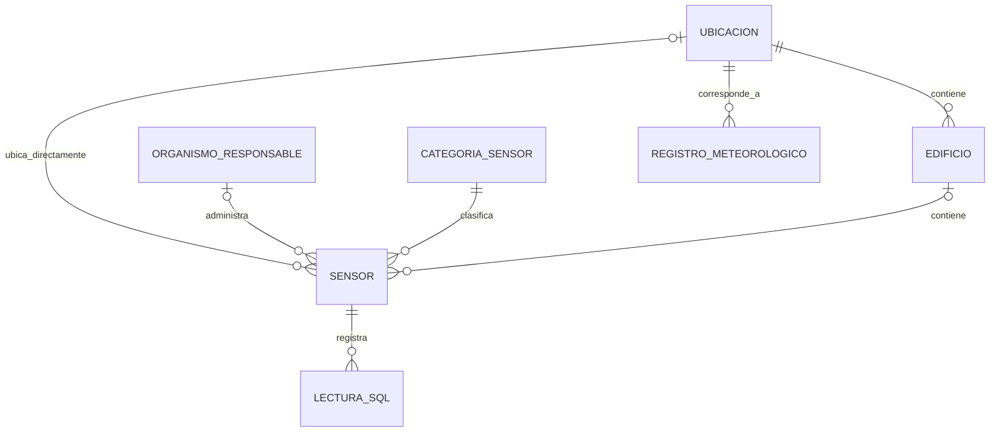

# SmartCityCE — Normalización del modelo PostgreSQL hasta 3FN

**Issue:** #3 — Normalizar esquema PostgreSQL hasta tercera forma normal  
**Área:** monitoreo y análisis energético urbano  
**Estado:** análisis del diseño lógico y propuesta de ajustes; aún no se ha implementado ni validado el DDL (Issue #4).

## 1. Objetivo

Verificar y documentar el cumplimiento de primera (1FN), segunda (2FN) y tercera forma normal (3FN) en las entidades propuestas para PostgreSQL, identificando posibles redundancias y proponiendo correcciones antes de implementar los scripts SQL. Todos los artefactos de esta Issue se ubican en `/docs/SQL/`.

## 2. Alcance y evidencia

Se revisó el diseño de la Issue #2 (`modelo_entidad_relacion.md` y `modelo_er.mmd`) junto con los campos previamente inspeccionados de los archivos BDG2 `metadata.csv`, muestra de `electricity_cleaned.csv` y Open-Meteo. El dataset de medidores está en formato *ancho*: `timestamp` más una columna por identificador de edificio/serie. Para el modelo SQL se contempla convertir las observaciones a filas de la forma `(sensor, fecha_hora, valor)`.

**Alcance de la verificación:** las conclusiones corresponden a un **esquema lógico propuesto** y a las reglas funcionales aquí definidas; no constituyen una auditoría de todas las filas de los archivos ni una comprobación de ejecución sobre PostgreSQL. La 3FN depende también de las reglas del negocio efectivamente adoptadas y aplicadas.

## 3. Criterios de normalización

- **1FN:** cada columna contiene valores atómicos del dominio definido; no hay grupos repetitivos de columnas para una misma entidad ni listas almacenadas en una celda.
- **2FN:** se cumple 1FN y ningún atributo no primo depende de una parte propia de una clave candidata compuesta. En el diseño actual se proponen identificadores de una sola columna como claves primarias, lo que simplifica este punto, pero no exime de revisar otras claves candidatas.
- **3FN:** se cumple 2FN y para toda dependencia funcional no trivial `X → A`, o `X` es superclave o `A` es atributo primo (pertenece a alguna clave candidata). Una dependencia transitiva entre atributos no primos es una alerta habitual de incumplimiento.

## 4. Dependencias funcionales propuestas

En la notación siguiente, `→` significa *determina funcionalmente*. Son reglas del diseño, no afirmaciones de que los datos de origen las cumplen sin excepciones.

| Relación | Dependencias principales | Comentario |
|---|---|---|
| `UBICACION` | `id_ubicacion → nombre_zona, distrito, latitud, longitud, zona_horaria` | No asumir que `nombre_zona` es único globalmente. |
| `EDIFICIO` | `id_edificio → id_ubicacion, uso_principal, subuso, superficie_m2, anio_construccion` | Se asume que el identificador BDG2 es estable y único en el dataset cargado. |
| `CATEGORIA_SENSOR` | `id_categoria → nombre_categoria, unidad_base` | Si `nombre_categoria` se declara único, será otra clave candidata. |
| `ORGANISMO_RESPONSABLE` | `id_organismo → nombre, responsable` | La relación organización–responsable no se obtiene de BDG2; será dato del sistema o sintético documentado. |
| `SENSOR` | `id_sensor → nombre, tipo_sensor, fecha_instalacion, estado, id_categoria, id_organismo, id_edificio, id_ubicacion, identificador_fuente` | `tipo_sensor` se mantiene solo si significa **subtipo técnico** distinto de la categoría general. |
| `USUARIO_SISTEMA` | `id_usuario → nombre, correo` | Puede imponerse `UNIQUE(correo)` cuando el negocio lo requiera. |
| `LECTURA_SQL` | `id_lectura → id_sensor, fecha_hora, valor, fuente` | Si no hay duplicados y una sola fuente por medición, `(id_sensor, fecha_hora, fuente)` podría ser clave candidata; hay que validar la regla antes de imponerla. |
| `REGISTRO_METEOROLOGICO` | `id_registro → id_ubicacion, fecha_hora, temperatura_c, humedad_relativa_pct, precipitacion_mm, nubosidad_pct, viento_kmh` | Se podría imponer unicidad `(id_ubicacion, fecha_hora)` **solo** si se almacena una observación por ubicación y hora. |

## 5. Revisión por forma normal

### 5.1 Primera forma normal (1FN)

El archivo original de medidores tiene una columna por serie (`Panther_...`, `Fox_...`, etc.). **No se copiará ese formato a una tabla SQL con una columna por medidor**: aunque el archivo CSV puede almacenarse así, sería un diseño poco flexible con grupos repetitivos de atributos. Se transforma a registros individuales:

| id_sensor | fecha_hora | valor |
|---|---|---|
| ID del medidor A | 2016-01-01 00:00:00 | valor disponible |
| ID del medidor B | 2016-01-01 00:00:00 | valor disponible |

*La tabla muestra la forma de los datos, no registros cargados ni valores inventados.*

Las entidades maestras tienen atributos escalares (identificador, nombre, categoría, etc.). `latitud` y `longitud` son coordenadas separadas; no se guardan listas de valores en un campo. Los valores faltantes de las series de medidores deben mantenerse como `NULL` o excluirse con una regla ETL documentada, nunca reinterpretarse como cero por defecto.

**Resultado 1FN:** el **modelo lógico transformado** satisface 1FN bajo estas reglas. Falta comprobar que el ETL las respete.

### 5.2 Segunda forma normal (2FN)

Las ocho entidades propuestas utilizan una PK de un solo atributo (`id_...` o `id_edificio`), por lo que no existen dependencias parciales respecto de esas PK. Se deben revisar además claves candidatas que se incorporen como restricciones `UNIQUE` durante el DDL, especialmente las de lecturas y registros horarios: sus campos descriptivos deben depender de la combinación completa que se declare clave.

**Resultado 2FN:** cumplida **según las claves y dependencias propuestas**, condicionada a validar las claves alternativas antes de implementarlas.

### 5.3 Tercera forma normal (3FN) y correcciones

La revisión identificó tres focos que requieren decisiones explícitas:

**A. `EDIFICIO.id_sitio_origen` y `EDIFICIO.id_ubicacion`**

En la Issue #2 ambos campos se guardaban en `EDIFICIO`. Si cada `id_ubicacion` representa un sitio BDG2 y su `nombre_zona` almacena precisamente el `site_id`, mantener el mismo `site_id` en la fila del edificio duplicaría la referencia al sitio. Esto crea una dependencia transitiva potencial `id_edificio → id_ubicacion → site_id`.

**Corrección adoptada para el diseño normalizado:** quitar `id_sitio_origen` de `EDIFICIO` y conservar `id_ubicacion` como FK. La trazabilidad del `site_id` original se conserva en `UBICACION.nombre_zona` **cuando la ubicación representa un sitio BDG2**, y en el archivo de origen/ETL. En la Issue #4 puede estudiarse añadir un campo `codigo_sitio_origen` con restricción de unicidad en `UBICACION` si se requiere distinguirlo del nombre legible; no hacerlo simultáneamente como dato duplicado del edificio.

**B. `SENSOR.tipo_sensor` y `SENSOR.id_categoria`**

Ambos aparecen porque el enunciado pide el atributo `tipo_sensor` y una entidad de categorías. Si `tipo_sensor` fuera simplemente una copia de `CATEGORIA_SENSOR.nombre_categoria`, se tendría la dependencia `id_sensor → id_categoria → nombre_categoria` y redundancia evitable.

**Decisión condicionada:** conservar ambos **únicamente** definiendo `tipo_sensor` como subtipo o modalidad técnica (`medidor_electrico`, `estacion_meteorologica`, etc.) y `CATEGORIA_SENSOR` como clasificación más amplia (por ejemplo, energía y ambiente). Estos son **ejemplos de valores a definir, no clasificaciones verificadas del origen**. Si el equipo decide que ambos campos expresan lo mismo, debe eliminarse `tipo_sensor` físico y exponerse como alias de la categoría en una vista SQL. No debe mantenerse una copia textual del nombre de la categoría.

**C. `SENSOR.id_edificio` y `SENSOR.id_ubicacion`**

Si la ubicación de un sensor instalado en un edificio está determinada por ese edificio, almacenar ambos campos simultáneamente puede provocar inconsistencias; se produciría la dependencia `id_sensor → id_edificio → id_ubicacion`.

**Corrección adoptada:** para un sensor vinculado a un edificio, almacenar `id_edificio` y dejar `id_ubicacion = NULL`; su ubicación se obtiene mediante `EDIFICIO.id_ubicacion`. Para un sensor que no pertenece a un edificio (por ejemplo, una fuente meteorológica), almacenar `id_ubicacion` y dejar `id_edificio = NULL`. El DDL deberá incorporar `CHECK (num_nonnulls(id_edificio, id_ubicacion) = 1)` si se confirma que **todos** los sensores quedan asociados a exactamente uno de esos dos objetos. La ubicación del sensor es entonces derivable por una consulta, pero no se duplicará en la misma fila.

**Resultado 3FN:** con la eliminación de `id_sitio_origen`, la regla de asociación exclusiva de sensores y el significado independiente de `tipo_sensor` frente a categoría, **no se identifican dependencias transitivas que impidan 3FN según las reglas propuestas**. Es una conclusión de diseño; debe validarse durante implementación y pruebas.

## 6. Estado final por entidad

| Entidad | 1FN | 2FN | 3FN | Observaciones |
|---|---|---|---|---|
| `UBICACION` | Propuesta conforme | Propuesta conforme | Propuesta conforme | Evitar usar `nombre_zona` como identificador único no demostrado. |
| `EDIFICIO` | Propuesta conforme | Propuesta conforme | Propuesta conforme tras ajuste | Se retira `id_sitio_origen` redundante. |
| `CATEGORIA_SENSOR` | Propuesta conforme | Propuesta conforme | Propuesta conforme | No copiar su nombre a `tipo_sensor`. |
| `ORGANISMO_RESPONSABLE` | Propuesta conforme | Propuesta conforme | Propuesta conforme | Datos adicionales no contenidos en datasets. |
| `SENSOR` | Propuesta conforme | Propuesta conforme | Propuesta conforme bajo reglas | FK de edificio/ubicación alternativa; subtipo distinto de categoría. |
| `USUARIO_SISTEMA` | Propuesta conforme | Propuesta conforme | Propuesta conforme | La unicidad de correo se define en DDL. |
| `LECTURA_SQL` | Propuesta conforme | Propuesta conforme | Propuesta conforme | Validar unicidad por tiempo, sensor y fuente. |
| `REGISTRO_METEOROLOGICO` | Propuesta conforme | Propuesta conforme | Propuesta conforme | Validar regla de una observación por ubicación y hora. |

## 7. Diagrama lógico actualizado

Archivo de documentación: [`modelo_er.mmd`](./modelo_er.mmd). El diagrama representa los ajustes adoptados. Las cardinalidades no expresan por sí solas la condición de **exactamente una** entre `SENSOR.id_edificio` y `SENSOR.id_ubicacion`; esa regla deberá escribirse como restricción en el DDL.

## 8. Consideraciones antes de la Issue #4

- [ ] Sincronizar el documento original de la Issue #2 (`/docs/SQL/modelo_entidad_relacion.md`) con las correcciones descritas aquí, para que no existan dos modelos contradictorios.
- [ ] Confirmar semántica real de `tipo_sensor`, distinta de `nombre_categoria`, y documentar un catálogo controlado.
- [ ] Definir tratamiento de `fecha_instalacion`, `estado`, `organismos` y `usuarios`: no están garantizados por los CSV reales y no deben inventarse como observaciones.
- [ ] Elegir cuáles FKs serán `NOT NULL`; `id_organismo` podría permanecer nulo hasta incorporar información válida.
- [ ] Especificar el uso de timestamps con zonas horarias para cruzar series BDG2 y Open-Meteo; no asumir coincidencia por el texto de fecha.
- [ ] Definir restricciones de unicidad y pruebas para lecturas duplicadas y registros meteorológicos, después de inspeccionar el dataset completo.
- [ ] Definir los índices en la Issue #6 y verificar rendimiento con volumen representativo.
- [ ] Revisar la procedencia y significado de los valores `0` en el dataset `cleaned` antes de interpretarlos como consumo real o ausencia de actividad.

## 9. Conclusión

La normalización plantea **ocho entidades**. El diseño corregido ofrece un esquema relacional en 3FN **si se respetan las dependencias funcionales y reglas de integridad explicitadas**. Se evita duplicar el sitio de un edificio, almacenar dos veces la ubicación efectiva de un sensor y repetir el nombre de una categoría como tipo. El paso siguiente es convertir el modelo en DDL con restricciones comprobables y pruebas de carga.

## 10. Referencias

- Enunciado del proyecto SmartCity Analytics, sección «Uso de PostgreSQL», requisitos de entidad-relación, normalización hasta 3FN, PK y FK.
- `/docs/SQL/modelo_entidad_relacion.md` — propuesta de la Issue #2 (requiere sincronización tras esta revisión).
- Building Data Genome Project 2: https://github.com/buds-lab/building-data-genome-project-2
- Open-Meteo Historical Weather API: https://open-meteo.com/en/docs/historical-weather-api
